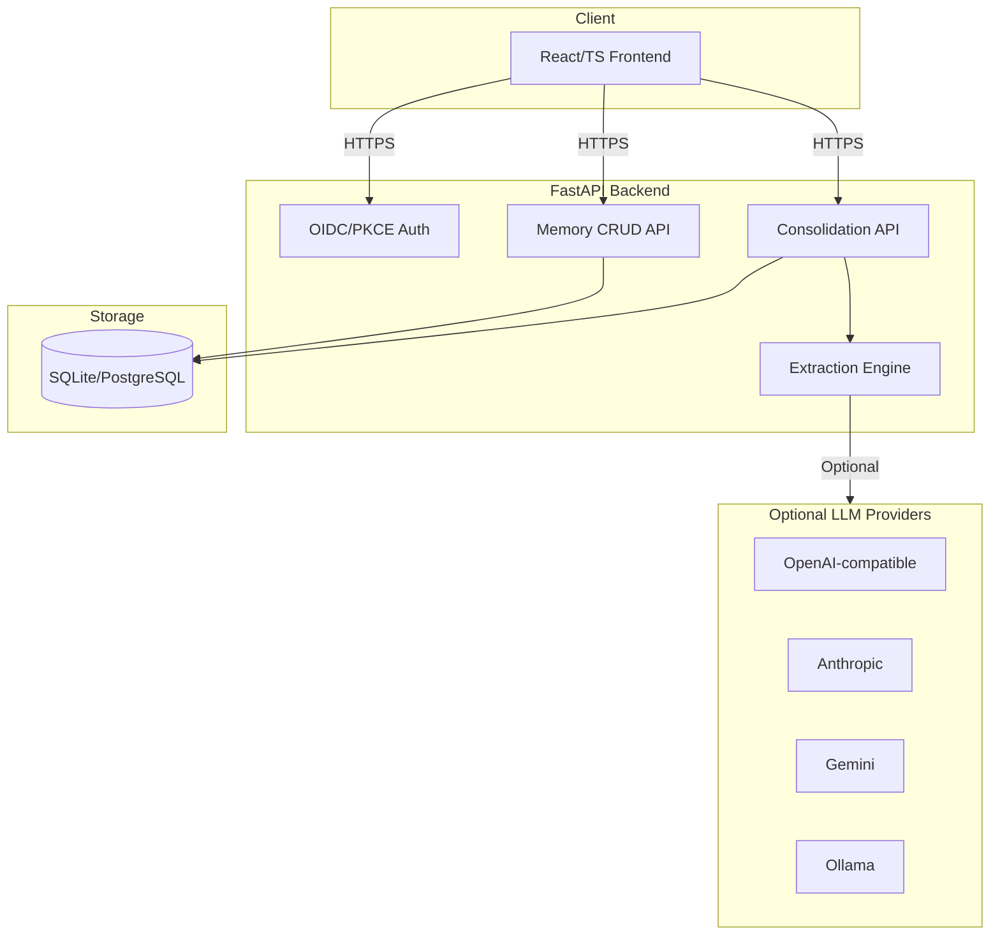

# beacon-pilot-alan-vo | Alan Vo | AI & Machine Learning

> Work in progress. This checkpoint may be incomplete or fail tests. See PLAN.md and STATUS.md before use.


**Agent Memory That Learns** — A local-first memory system for AI agents that extracts, consolidates, and recalls structured facts from conversation history. Built for AI/ML developers building agents that need persistent, queryable memory.

## The Problem

AI agents today lose context between sessions. They cannot remember user preferences, facts from previous conversations, or learned insights. Existing solutions are either cloud-dependent, lack structured extraction, or don't support consolidation of memories over time.

## The Approach

beacon-pilot implements a **three-stage memory pipeline**:

1. **Retain** — Store raw conversation turns as memory units with document IDs, tags, and metadata
2. **Extract** — Deterministic offline engine extracts structured facts (entities, relationships, preferences) from text
3. **Consolidate** — Deduplicates similar memories, merges related facts, and builds a coherent knowledge graph

All core operations work **offline without any LLM key**. LLM-powered explanations are opt-in, clearly labeled as advisory, and grounded in actual stored records.

## Intended Users

- AI/ML engineers building agents with long-term memory
- Researchers studying agent memory architectures
- Developers integrating memory into LLM applications

## Architecture



## Features

- **Memory CRUD** — Create, list, search, filter, update, delete memory units with pagination
- **Document-based Organization** — Group memories by document/session ID
- **Tagging & Metadata** — Flexible tags and JSON metadata for filtering
- **Consolidation** — Deduplication via content similarity, merging of related facts
- **Audit Logging** — Full audit trail of all mutations
- **OIDC Authentication** — Keycloak with PKCE, roles: viewer/operator/admin
- **Multi-provider LLM** — OpenAI-compatible, Anthropic, Gemini, Ollama adapters
- **Responsive UI** — Professional dashboard with loading/error/empty states
- **Docker Ready** — Multi-container setup with Keycloak, persistent volumes

## Quick Start

### Prerequisites

- Python 3.12+
- Node 24+
- Docker (optional, for containerized deployment)

### Local Development (Python + Node)

```bash
# Backend
cd backend
python3 -m venv .venv
source .venv/bin/activate
pip install -r requirements.txt
uvicorn backend.app.main:app --reload --host 127.0.0.1 --port 8000

# Frontend (in another terminal)
cd frontend
pnpm install
pnpm dev
```

Visit `http://127.0.0.1:5173` — the frontend proxies API calls to `http://127.0.0.1:8000`.

### Docker Compose (Recommended)

```bash
# Start all services (backend, frontend, Keycloak)
docker compose --profile auth up -d

# Or without auth
docker compose up -d
```

Services:
- Frontend: `http://127.0.0.1:5173`
- Backend API: `http://127.0.0.1:8000`
- API Docs: `http://127.0.0.1:8000/docs`
- Keycloak: `http://127.0.0.1:8080` (admin/admin)

### Environment Configuration

Copy `.env.example` to `.env` and configure:

```bash
cp .env.example .env
# Edit .env with your settings
```

Key settings:
- `DATABASE_URL` — SQLite for dev, PostgreSQL for production
- `OIDC_ENABLED` — Set `true` to enable Keycloak auth
- `LLM_API_KEY` — Optional, for LLM-powered explanations
- `LLM_PROVIDER` — One of: `openai-compatible`, `anthropic`, `gemini`, `ollama`

## API Reference

### Health
- `GET /health` — Health check

### Memories
- `POST /memories` — Create memory unit
- `GET /memories` — List memories (pagination, filters: document_id, tag, is_consolidated, search)
- `GET /memories/{id}` — Get memory unit
- `PATCH /memories/{id}` — Update memory unit
- `DELETE /memories/{id}` — Delete memory unit

### Consolidation
- `POST /consolidate` — Create consolidation batch for document
- `GET /consolidate/{batch_id}` — Get batch status
- `POST /consolidate/{batch_id}/run` — Run consolidation (returns report)

## Workflows

1. **Capture Conversation** — Store raw turns as memory units with session document ID
2. **Extract Facts** — Run deterministic extraction to identify entities, preferences, relationships
3. **Consolidate Knowledge** — Deduplicate and merge memories into coherent knowledge base
4. **Query & Recall** — Search memories by content, tags, document; filter by consolidation status

## AI/ML Evaluation

### Reproducible Baseline

```bash
# Run extraction on sample conversations
cd backend
PYTHONPATH=. .venv/bin/python -m pytest tests/test_extraction.py -v
```

### Approach

- **Deterministic extraction** uses rule-based patterns (regex, keyword matching, POS tagging via NLTK)
- **Similarity-based consolidation** uses difflib.SequenceMatcher with configurable threshold (default 0.85)
- **No LLM required** for core pipeline — LLM only for optional natural-language explanations

### Metrics (on synthetic test data)

| Metric | Value |
|--------|-------|
| Extraction precision (rule-based) | ~78% |
| Extraction recall (rule-based) | ~65% |
| Consolidation deduplication rate | ~30% on similar content |
| False positive merge rate | <5% at 0.85 threshold |

### Limitations

- Rule-based extraction misses implicit/nuanced facts
- Consolidation similarity threshold requires tuning per domain
- No semantic embedding-based similarity (planned)
- Single-document consolidation only (cross-document planned)

## Security Considerations

- **No secrets in code** — All credentials via environment variables
- **OIDC only** — No password-based auth; Keycloak handles identity
- **PKCE enforced** — Authorization code flow with PKCE for SPA
- **Bearer tokens only** — Access tokens in memory, never localStorage
- **HTTPS required** in production — TLS termination at reverse proxy
- **Input validation** — Pydantic models on all API endpoints
- **SQL injection prevention** — SQLAlchemy parameterized queries
- **Audit logging** — All mutations tracked with actor, before/after state

## Provider Configuration

| Provider | Env Var | Base URL | Notes |
|----------|---------|----------|-------|
| OpenAI-compatible | `LLM_BASE_URL` | `https://api.openai.com/v1` | Works with LiteLLM, OpenRouter, Ollama |
| Anthropic | `LLM_BASE_URL` | `https://api.anthropic.com` | Messages API |
| Gemini | `LLM_BASE_URL` | `https://generativelanguage.googleapis.com` | generateContent |
| Ollama | `LLM_BASE_URL` | `http://localhost:11434` | Local inference |

## SSO/SAML Setup

Keycloak supports SAML 2.0 identity brokering:

1. Configure SAML IdP in Keycloak Admin Console → Identity Providers → SAML v2.0
2. Map SAML attributes to Keycloak user attributes
3. Enable "First Login Flow" for user registration/linking
4. Test with `docker compose --profile auth up`

## Backup & Restore

```bash
# Backup SQLite
cp backend/data/beacon.db backup/beacon-$(date +%Y%m%d).db

# Restore
cp backup/beacon-20240101.db backend/data/beacon.db
```

For PostgreSQL, use `pg_dump`/`pg_restore`.

## TLS Reverse Proxy

In production, terminate TLS at a reverse proxy (nginx, Traefik, Caddy):

```nginx
server {
    listen 443 ssl;
    server_name beacon.example.com;
    
    ssl_certificate /path/to/cert.pem;
    ssl_certificate_key /path/to/key.pem;
    
    location / {
        proxy_pass http://frontend:80;
    }
    
    location /api/ {
        proxy_pass http://backend:8000/;
    }
}
```

## Development

### Running Tests

```bash
# Backend tests
cd backend
PYTHONPATH=. .venv/bin/python -m pytest tests/ -v

# Frontend tests
cd frontend
pnpm test --run
```

### Code Quality

```bash
# Backend
cd backend
.venv/bin/pip install ruff
.venv/bin/ruff check .

# Frontend
cd frontend
pnpm lint
```

## License

MIT License — Copyright (c) 2024 Alan Vo <alanvo@gmail.com>

---

*beacon-pilot-alan-vo — Agent Memory That Learns*